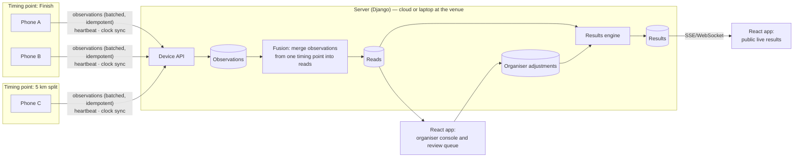

# Race Timing System — Rebuild Plan

> Status: **draft for discussion** · Last updated 2026-11-12

## 1. Goals

- **Open-source, self-hostable** race timing for grassroots events. A club should be able to run it with a laptop and a few phones.
- **Phones are the cameras.** Bib detection and recognition run on the phone, and more than one phone can cover the same line to reduce occlusion.
- **Groups of phones form timing points** (start, splits, finish), which gives split timing.
- **No result is ever lost silently.** Every detection is stored, synced with retries, and anything uncertain goes to a human review queue.
- **Accuracy is measured, not claimed.** A repeatable evaluation harness runs on recorded footage with ground truth.

### Non-goals for v1
Payments and registration checkout, runner accounts, RFID integration, a native desktop GUI, live two-way laptop ⇄ cloud sync, a public hosted instance, and SaaS billing.

## 2. Lessons from the legacy system (kept on the `legacy` tag)

| Problem | Fix in the rebuild |
|---|---|
| Finish time = `time.time()` at the last OCR read, after processing; no finish line | Time comes from the **camera frame timestamp** when a track **crosses a virtual line**, with each device's clock offset to the server corrected |
| Uploads run in a background thread with no retry; unknown or low-confidence bibs are dropped | **On-device outbox** with idempotent batch sync. Every observation is stored, and uncertain ones go to the **review queue** |
| Results stored as `"HH:MM:SS"` strings; no positions, statuses or duplicate protection | Results are **calculated** from an append-only log of reads, using `DurationField`/`DateTimeField`, with explicit DNS/DNF/DSQ |
| One 2.4k-line `views.py`, `DEBUG=True`, plain-text tokens, secrets committed | Layered apps, settings driven by environment variables, hashed device tokens, secret scanning in CI |
| General-purpose OCR (EasyOCR) on Otsu-thresholded crops | A small **digit recogniser** built for bibs, with output **snapped to the list of registered bibs** |
| `Participant` linked to `Race` through both a foreign key and a many-to-many; race names unique site-wide | A clean Event → Race → Wave → Entry model (§4) |

## 3. Architecture



**The same server runs in the cloud or on a laptop at the venue.** In event mode, the laptop **checks out** the event: it's the only copy that can be edited on the day, phones and staff tablets connect to it over local Wi-Fi, and it pushes results to the cloud whenever it has signal and checks the event back in afterwards. There's no two-way sync. Phones never rely on a live connection, because everything goes through their outbox. See [ADR 0002](decisions/0002-event-mode-and-accounts.md).

### Monorepo layout
```
server/        Django + DRF (or Ninja), Postgres, Celery/RQ for background jobs
web/           React + TypeScript + Vite, API client generated from OpenAPI
mobile/        Capture app (stack chosen by the Phase 3 spike)
vision/        Python reference pipeline, training scripts, evaluation harness
protocol/      Device ⇄ server contract (OpenAPI + JSON schemas), shared test fixtures
docs/
```

## 4. Domain model (first draft)

*All synced models use UUIDv7 primary keys and carry an `event` foreign key where they belong to an event. The core models must work on both Postgres (cloud) and SQLite (venue laptop).*

- **Organisation**, with members and roles (owner, organiser, volunteer). Many organisations per install
- **Event**: name, venue, *timezone*, date(s), checkout lease (node, time, state). It contains:
  - **TimingPoint**: a physical line where phones watch, e.g. "Finish". Several races can share one
  - **Race**: distance, ranking basis (gun or net time), category scheme
    - **Wave**: `start_at` (timezone-aware), set by the starter or from a start-line read
    - **Split**: where a timing point falls on this race's course (kind start/split/finish, distance, order). Laps list the same timing point more than once, with `min_elapsed` to tell passes apart
  - **Entry**: bib (unique across the event, so one shared finish line can identify everyone), name, date of birth (or age on race day), gender, club, wave, status (`registered | started | finished | DNS | DNF | DSQ`), optional email (for results), `hide_name` flag. **No runner accounts in v1**
- **CategoryScheme / CategoryRule**: age and gender bands, calculated from age *on race day*
- **Device**: paired to an event by QR code, *hashed* token, assigned timing point, measured clock offset, last heartbeat (battery, temperature, fps)
- **Observation** (append-only, written by a device): client UUID, device, timing point, frame timestamp (device clock and corrected), track id, ranked bib candidates with confidences, crop image, line-crossing direction
- **Read** (made by fusion): timing point, bib (or *unknown*), time, linked observations, state (`auto | needs_review | confirmed | rejected | manual`)
- **Adjustment** (audit trail): who changed what, when, and why. Covers manual times, bib reassignments, penalties and DSQs
- **Result** (stored, rebuilt whenever reads or adjustments change): gun time, chip time, splits, overall / gender / category position

## 5. Device ⇄ server protocol

> Implemented in slice 1.3 with Django Ninja. The contract is [`protocol/openapi.json`](../protocol/openapi.json) (generated, and checked in CI). The guide for app developers is [`protocol/README.md`](../protocol/README.md). The sketch below is the original outline.

1. **Pairing:** an organiser shows a QR code (one-time code + server URL + event + the TLS certificate fingerprint when the server is a venue laptop). The phone swaps it for a device token scoped to that event, then picks or is assigned a timing point.
2. **Clock sync:** the device pings the server repeatedly, NTP-style, and the server keeps the device's offset and its drift. Every observation carries both the raw frame timestamp and the offset used.
3. **Observations:** `POST /devices/me/observations:batch` with client UUIDs, so resending the same batch is safe. Crop images upload separately, also idempotent and with lower priority.
4. **Heartbeat:** battery, temperature, frames per second, outbox size, and whether the camera is in view. Shown live in the organiser console.
5. **Config push:** line position, region of interest, confidence thresholds, and the list of valid bibs (so the phone can snap readings to it).

## 6. Vision strategy

- **Detection:** a permissively licensed bib detector (YOLOX-Nano, RF-DETR Nano or D-FINE-N, chosen by the Phase 3 spike) behind an ONNX interface, converted to CoreML / TFLite / NCNN. **No Ultralytics in anything we ship.** See [ADR 0001](decisions/0001-licence-and-detector.md).
- **Recognition:** replace general OCR with a **digit-level model**. Either YOLO with 10 digit classes run on the bib crop, or a tiny CRNN. It's far cheaper than EasyOCR, runs on the phone's neural-network chip, and handles bib fonts better.
- **Combine readings across frames:** accumulate a confidence per digit over the life of a track, then match the result against the registered bib list using edit distance. A probable 3-digit read that matches exactly one entered bib becomes a confident read.
- **Timing:** the moment the torso or bib box centre crosses a configurable line, interpolated between frames. Real systems time on the torso, so a person detector may beat the bib box. The evaluation harness will settle it.
- **Fusion (server-side):** observations from phones at the same timing point within a ±N s window, with compatible bibs, merge into one read. Conflicts and solitary low-confidence reads go to review.

### Data strategy (starting with no footage)

We have no recorded races yet, so data collection starts in Phase 0 and runs in parallel with everything else, because organiser permission takes time to arrange.

1. **Start with public and synthetic data, at no cost**
   - Roboflow [`bibracenumber`](https://universe.roboflow.com/edoardo-cittadini-barxf/bibracenumber) (the source of the legacy `best.pt`). *Check its licence before redistributing any weights.*
   - The RBNR racing-bib dataset (Ben-Ami et al.) for evaluation. Check its terms; it may be research-only.
   - SVHN for pre-training the digit recogniser.
   - **Synthetic bibs:** render random numbers in typical bib fonts and colours, then add perspective, creases, blur, motion blur and partial occlusion, and composite them onto runner crops. Bib numbers form a closed set we control, so synthetic data should go a long way for the digit model.
2. **Staged sessions with consent, first-hand and soon:** a club track session or friends with printed bibs. These let us script the hard cases (bunched finishes, occlusion, low sun, rain, bibs on shorts, sprint finishes) and give exact ground truth. It's also the only footage we can **publish as an open dataset**, as long as participants explicitly agree.
3. **Real races, with permission:** a local club race or cross-country fixture (the season is under way now). Get the organiser's sign-off, put a notice at the finish and a line in the entry privacy notice, and get the race's official results to use as ground truth. Film with **two phones** at the finish to test multi-camera from day one. Real-race footage stays private: it's for internal evaluation only and is deleted on a set schedule.
4. **Recording protocol (until the app can record):** stock camera at 60 fps, phones locked off on tripods. Start each clip by filming an internet-synced clock (e.g. time.is) so the video can be lined up with the official times. Note the camera height, distance and angle for each clip.
5. **Labelling:** CVAT or Label Studio, pre-labelled with the legacy `best.pt` to save time. Ground truth per runner = bib number + the frame where they cross the line + an occlusion flag.
6. **Governance:** footage of identifiable people is personal data under UK GDPR, *even in a public place*. The legacy ethics doc gets that wrong. Write a short data policy covering the lawful basis, notices, retention (e.g. crops deleted 30 days after results are final), access requests, and what can be published.

A useful side effect: the capture app's first build should be a **"record only" mode** that saves video with the sensor's frame timestamps and the measured clock offset. From then on, every outing produces data we can evaluate against.

### Phone battery and heat budget
- **Duty cycling:** cheap motion or frame-difference gating, so the detector drops to around 2 fps when the course is empty and runs at full rate when runners approach.
- **Recognition only where it's needed:** run the digit model only on crops near the line, and only until a track's bib is confident.
- **Region of interest:** crop to the lane before inference, with a lower input resolution where possible.
- **Hardware acceleration:** CoreML/ANE on iOS, NNAPI/GPU delegate on Android, measured rather than assumed.
- **Practical guidance:** recommend a power bank and a sun shade. Expose battery and temperature in the heartbeat and warn early.
- **Fallback mode:** the phone only detects, tracks and crops, then streams crops to the venue laptop for recognition. This keeps weak phones usable.

## 7. Phases

Each phase ends with something demonstrable. Phases 1 and 2 can run alongside each other.

### Phase 0: Housekeeping (days)
- [ ] **Rotate every secret in `running/running/.env`** (email password, OAuth secrets, `SECRET_KEY`)
- [x] Tag `main` as `legacy` (annotated tag; **not pushed yet**) and start the `v2` branch
- [ ] Push the tag and `v2`; archive the `rebuild/*` and `feature/PaddleOCR` branches as tags
- [x] Create the monorepo layout, tooling (uv, ruff, mypy, pytest, pnpm, eslint, prettier, vitest), pre-commit, secret scanning (gitleaks) and CI
- [x] docker-compose for the dev stack (Postgres, server, web)
- [x] Model weights out of git: `best.pt` stays on the `legacy` tag only, and `.gitignore` blocks weights and datasets. New weights get published through GitHub Releases
- [x] Licence: **AGPL-3.0-or-later** ([ADR 0001](decisions/0001-licence-and-detector.md)). `LICENSE` replaced on `v2`, DCO check in CI, SPDX headers + `reuse lint`, Ultralytics import guard
- [ ] Have the draft app-store permission ([LICENSE-APPSTORE-EXCEPTION.md](../LICENSE-APPSTORE-EXCEPTION.md)) reviewed before the first mobile release
- [ ] **Data:** contact 1–2 local clubs or race organisers about filming a finish; book a staged session with consent; write the data policy (§6, Data strategy)

### Phase 1: Core server (≈2–3 weeks)

Delivered as PR-sized slices into `v2`, roughly in this order:

| Slice | Contents |
|---|---|
| 1.1 Domain models ✅ | UUIDv7 base model, user/organisation/membership, event/race/wave/timing point/split/entry/categories, admin |
| 1.2 Results engine ✅ | Pure module: gun/chip time, splits and laps, statuses, positions, categories |
| 1.3 Device protocol ✅ | API framework, pairing, clock sync, observation ingestion, heartbeat, OpenAPI + `protocol/` contract tests |
| 1.4 Fusion v1 | Reads from observations, review states, adjustments/audit log, result rebuilds |
| 1.5 Auth | django-allauth headless, passkeys, TOTP, invites, role permissions on the API |
| 1.6 Data in/out | CSV import/export (legacy-compatible), versioned event bundle export/import |

- [ ] Domain models from §4 with migrations, Django admin as the stopgap UI
- [ ] Auth: django-allauth (headless) with email + password, passkeys and TOTP (2FA required for owners and organisers), email invites, organisation roles. No social login
- [ ] Event-mode groundwork: UUIDv7 keys, event scoping, **event bundle export/import** (versioned, idempotent), CI against both Postgres and SQLite
- [ ] Device pairing, clock sync, observation ingestion (idempotent) and heartbeat
- [ ] **Results engine as a pure, heavily tested module:** gun and chip time, splits, statuses, positions and categories
- [ ] Fusion v1 (single camera per timing point), review states, audit log
- [ ] CSV import and export for entries and results. Keep compatibility with the legacy CSV examples
- [ ] OpenAPI schema published, contract tests in `protocol/`

### Phase 2: Vision reference pipeline and evaluation (≈2–4 weeks, alongside Phase 1)
- [ ] Synthetic bib generator, and train the digit model on synthetic data + SVHN + Roboflow crops
- [ ] Label the first staged session (and a race, once one is available). Ground truth = bib + crossing frame for each runner
- [ ] Until real footage exists, the harness runs on the public datasets (still images, so recognition only). Timing accuracy is measured once the staged footage is in
- [ ] Python reference pipeline in `vision/`: detection, tracking, line crossing, digit recognition, bib-list snapping
- [ ] Evaluation harness: **detection recall, bib accuracy, timing error (p50/p95), false-read rate**, with a report per clip
- [ ] Train the digit recogniser and compare it against EasyOCR and PaddleOCR baselines
- [ ] "Simulated device": replays footage and talks the real device protocol. This becomes the end-to-end test rig

### Phase 3: Mobile spike, then capture app (spike ≈1–2 weeks, app ≈4–6 weeks)
- [ ] **Spike:** export the shortlisted detectors (YOLOX-Nano, RF-DETR Nano, D-FINE-N) and measure recall, fps, battery drain per hour and heat on one mid-range Android phone and one iPhone. Compare React Native + VisionCamera frame processors + fast-tflite against native or Flutter. **Decision record** at the end
- [ ] Capture app: QR pairing, camera + line set-up overlay, on-device pipeline, SQLite outbox, background sync, heartbeat, low-power mode
- [ ] Manual tap mode as a backup: a volunteer taps on each crossing, and the times are matched to bibs later

### Phase 4: Web app (≈3–4 weeks, can start after Phase 1)
- [ ] Public site: events, live results (SSE), runner result pages, searching and filtering
- [ ] Organiser console: event, race, wave and timing-point set-up, entry management, device dashboard, **start-gun button**
- [ ] **Review queue:** unknown or conflicting reads shown with their crops. One click to assign a bib, confirm or reject
- [ ] Publishing results, corrections, and certificates/exports

### Phase 5: Multiple cameras and splits (≈2–3 weeks)
- [ ] Fusion v2: several devices per timing point, conflict resolution, per-device health weighting
- [ ] Split timing points and course validation (missed split → flagged)
- [ ] Start-line timing for chip times

### Phase 6: Event mode on a venue laptop (≈3–4 weeks)
- [ ] `NODE_MODE=venue`: the server runs on a laptop with SQLite and a docker-compose `venue` profile
- [ ] Checkout and check-in with the cloud, event lock and lease, force-release, standalone mode with no cloud
- [ ] Opportunistic one-way push of reads and results while the event runs
- [ ] Self-signed TLS with the fingerprint pinned through the pairing QR. QR pairing for staff browsers (sessions scoped to the event and a role)
- [ ] Field test: phones + laptop + travel router, no internet

### Phase 7: Running it in production and the open-source release
- [ ] Production Docker images, Caddy, Postgres backups, S3-compatible storage for crops, Sentry
- [ ] Docs site: organiser guide, hardware guide (mounts, power, angles), self-hosting guide, contributor guide
- [ ] First real event pilot, then a retrospective

### Later
Optional runner accounts (claiming results, notifications), registration and payments, photo galleries per runner, a public API, a timing mat / RFID bridge, a one-click venue installer, and a public hosted instance (after a pilot, with a data processing agreement and privacy policy).

## 8. Open questions

1. ~~Footage~~: **none yet.** Data collection now starts in Phase 0 (§6, Data strategy).
2. **Training data:** the legacy `best.pt` was trained on the Roboflow `bibracenumber` dataset (according to the deleted `docs/training_data.md`). Its licence still needs checking.
3. **First filming opportunity:** is there a club or race organiser we can approach, and when is the next suitable event?
4. **Mobile stack:** decided by the Phase 3 spike. Is supporting both iOS and Android in v1 a requirement?
5. ~~Venue connectivity~~: **decided:** event mode through checkout is in v1 ([ADR 0002](decisions/0002-event-mode-and-accounts.md)).
6. ~~Accounts~~: **decided:** no runner accounts in v1; multiple organisations per install; staff sign in with email + passkeys/TOTP ([ADR 0002](decisions/0002-event-mode-and-accounts.md)).
7. ~~Licence~~: **decided: AGPL-3.0-or-later** with a permissively licensed detector ([ADR 0001](decisions/0001-licence-and-detector.md)).
