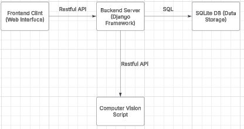

# High-Level System Architecture

This document describes the high-level system architecture of the Automatic Race Timing System prototype, including the
main components and their interactions. The architecture is designed to ensure scalability, reliability, and ease of
use. The system includes the following primary components:

1. **Frontend Client**  
2. **Backend Server (Django)**  
3. **Database (SQLite)**  
4. **Computer Vision Script (YOLOv11 model)**  
5. **Cloud Storage and Hosting Services (via University hosting)**

The architecture diagram at the end of this document provides a visual representation of the components and how they
interact with one another.

## System Components

### 1. Frontend Client
The frontend is the user interface that interacts with users, allowing them to access the dashboard, view race results,
and monitor the timing system. It is a web-based application built using HTML, CSS, and JavaScript. The frontend
communicates with the backend via RESTful API requests.

- **Key Features**: 
  - Displaying race times and results
  - User authentication (register/login/logout)
  - Allowing users to view race data
  - Responsive design for accessibility on both desktop and mobile devices
  - Allows race organisers to set up and configure races and upload the participant data

### 2. Backend Server (Django)
The backend server is built using Django, a high-level Python web framework. It is responsible for processing requests
from the frontend, handling logic, interacting with the database via SQL, and providing APIs for the computer vision
script.

- **Key Features**:
  - Provides RESTful APIs to the frontend
  - Manages user authentication and authorisation
  - Handles database interactions and stores user data, race data, and logs
  - Processes race results, gathered from the computer vision models for race timing and processing images
  
### 3. Database (SQLite)
The system uses SQLite, a lightweight, serverless, and self-contained relational database management system, to store
data persistently. The database contains tables for race events, user information, race results and participant 
information

- **Key Features**:
  - Stores user information (authentication, profile data)
  - Stores race event details (race date, participants, results)
  - Provides simple and efficient querying for retrieving race data
  
### 4. Computer Vision Script (YOLOv11 model)
A script which takes in camera input, processes using the computer vision models, in order to recognise bibs.
Uses OCR (Optical Character Recognition) in order to extract the bib number, and accurately calculates the time for that 
runner.

- **Key Features**:
  - Takes input from a user's camera
  - Detects runners in video footage
  - Identifies and reads bib numbers using image processing techniques
  - Provides time stamps for each runner crossing the finish line

### 5. Storage and Hosting Services (Provided by the university)
Hosting and storage services will be used to host the backend and store large video files, images, and race data, in the
SQLite database.

- **Key Features**:
  - Video storage and file management (e.g., storing race videos for review)
  - Backend hosting using university infrastructure

## Architecture Diagram
Below is a block diagram illustrating the system components and their interactions.

