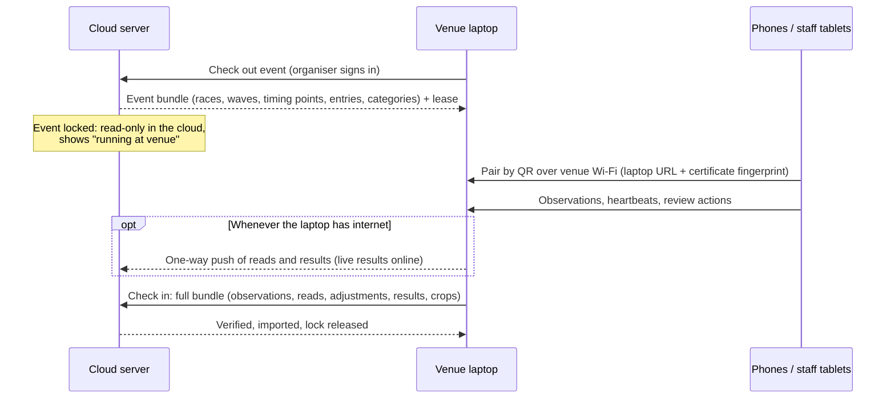

# ADR 0002: Event mode (venue laptop) and accounts

- **Status:** Accepted (2026-11-12)
- **Context:** [Rebuild plan](../REBUILD_PLAN.md) §3–§5 and §7

## Decisions

1. **v1 includes event mode via checkout.** A laptop at the venue runs the event and uploads it to the cloud afterwards. There's **no live two-way sync**.
2. **No runner accounts in v1.** Results are public, entries carry an optional email address, and runners can hide their name.
3. **Multiple organisations per install from day one.** Self-hosting with docker-compose comes first. A public hosted instance waits until after a pilot.
4. **Staff sign in with email + password and passkeys / TOTP 2FA** through django-allauth in headless mode. No social login.

## 1. Event mode: checkout and check-in

The laptop runs **the same server software** as the cloud (one codebase, a `NODE_MODE=venue` setting). It's an "event node".

**Rules that keep it simple**
- **Only one copy of the event can be changed at a time.** While the event is checked out, the cloud copy is read-only. That avoids merge conflicts entirely.
- **Data only flows one way during the event** (laptop to cloud), and only opportunistically. It means live results reach the internet whenever there's any signal, at no extra complexity.
- **Lost laptop:** an organiser can **force-release** the lock in the cloud (with a warning). After that, check-in from the old lease is refused. Its bundle can still be imported by hand as a review job.
- **Standalone use:** a self-hoster without a cloud server just runs the laptop node with no upstream. Same software, same features.

**What this needs from day one (Phase 1), even before event mode is built**
- **UUIDv7 primary keys** on every model that's synced, so records made on different machines never collide.
- Every event-scoped model has an `event` foreign key, so "everything in this event" is one query.
- A versioned **event bundle format**: JSON Lines per model plus a media folder, in a zip, with a manifest that includes the schema version and checksums. Export/import is idempotent.
- **Compatibility check on checkout:** the laptop and the cloud must run compatible bundle schema versions.
- **No Postgres-only features in the core models**, because the laptop runs SQLite (WAL mode) so non-technical organisers don't have to run Postgres. CI runs the test suite against both databases.

**Networking at the venue**
- The laptop provides the Wi-Fi (a phone hotspot or a cheap travel router). Phones join it, and the pairing QR contains the laptop's LAN address.
- **TLS on the local network:** the laptop generates a self-signed certificate and puts its **fingerprint in the pairing QR**, and the app pins it. This avoids plain HTTP without needing a public certificate. The iOS app needs `NSAllowsLocalNetworking` and the local-network permission prompt.
- **Clock:** the laptop is the time reference for the phones. Its own offset from real time is measured against the cloud at checkout and check-in (and by NTP when online), and stored in the bundle.

**Packaging:** v1 ships a docker-compose `venue` profile. **Later:** a one-click installer for non-technical organisers (e.g. Briefcase/PyInstaller, or a Tauri wrapper).

## 2. Accounts and roles

| Who | How they authenticate | Notes |
|---|---|---|
| Instance admin | Django superuser | Creates organisations. `ALLOW_ORG_SIGNUP=false` by default when self-hosted |
| Organisation owner / organiser / volunteer | django-allauth (headless) with email + password, passkeys and TOTP. **2FA required for owners and organisers** | Invited by email. Roles per organisation. Volunteers can review reads and run devices but can't edit the event set-up |
| Camera phones | Device token from QR pairing (hashed, scoped to the event) | No user account |
| Staff at the venue (event mode) | **Pair their browser with a QR code** shown on the laptop: a session for that event with a role | Passkeys only work on the domain they were created for, so they can't work on a laptop's LAN address. We also don't copy password hashes onto laptops. Being physically at the laptop is the authentication |
| Runners and the public | None | Public results and search. Results emailed to the address on the entry. A **"hide my name"** flag per entry shows them as "Anonymous" |

**Runner privacy (data minimisation):** store date of birth only when a category scheme needs it, and only ever show the *category*, never the age or date of birth. Entry emails are used only for results and race notices, and are deleted with the event's data when the retention period ends.

## Consequences
- Adds an **event mode phase** (≈3–4 weeks) before the production release. Phase 1 takes on the UUID, event-scoping and bundle-format work described above.
- The core models must work on both Postgres and SQLite, so there are some limits: no `ArrayField`, and full-text search goes through a small abstraction.
- The mobile app has to support connecting to either a public HTTPS server or a laptop with a pinned certificate. The protocol spec covers both from the start.
- Runner accounts (claiming results, notifications) can be added later without migrating anything, because entries already carry an optional email address.
