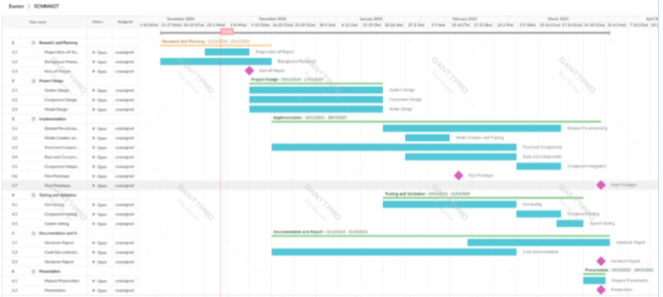

## Project Plan

### Project Aims
The aim of the project is to develop a complete system for recording and live updating the results of races. The system should provide a complete package for race organisers that is easy to use, regardless of their technical ability and provide results which lie within an acceptable degree of accuracy.

### Project objectives
- Computer vision model for recognising runners
- Computer vision model for recognising bibs
- Model to associate runners with corresponding bibs
- Model for recognising finishing times
- System for uploading results

### Stretch goals
- Multiple camera configuration for improved accuracy and occlusion reduction
- Race website
- Configurable augmented reality finish line creation

### Gantt chart
