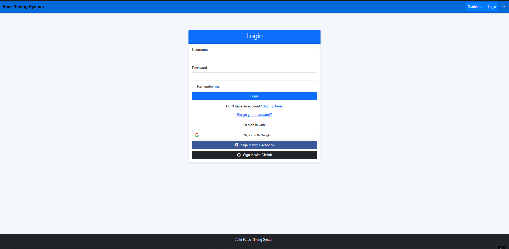
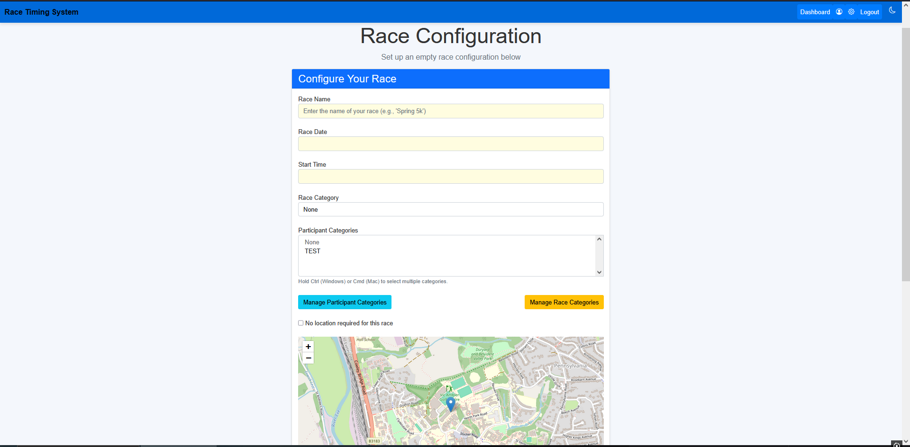
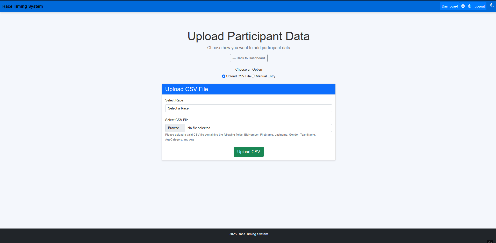
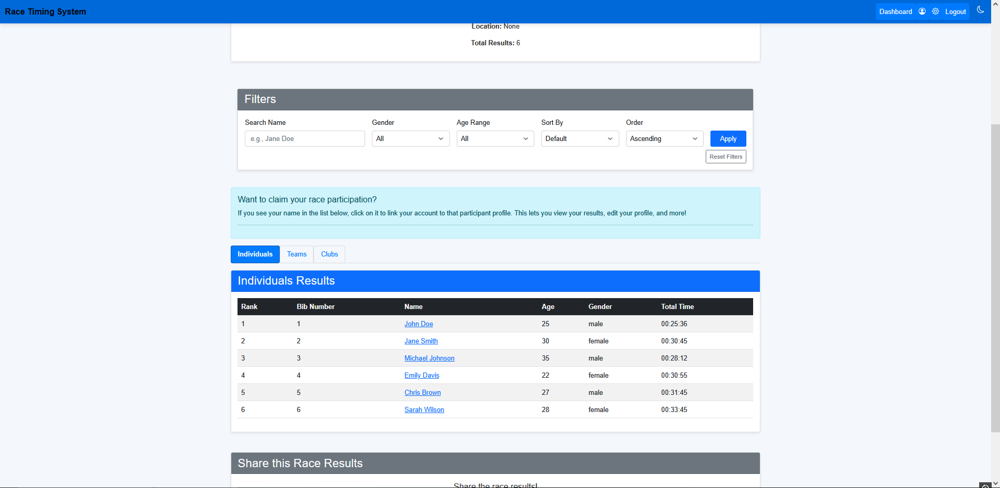

# Usage Guide – First Steps

## Overview
The following guide covers the basic usage of the Automated Race Timing System. This will help you get started quickly
and complete a simple task to verify that the system installation works properly. 

### 1. Logging into the System

To access the system, follow these steps:

- Open a browser and navigate to the URL where the system is hosted, e.g., `http://127.0.0.1:8000/` for local
development.
- On the landing page, you will see two options: **Login** and **Register**.
  - If you already have an account, click **Login** and enter your credentials (username and password).
  - If you're a new user, click **Register** to create an account. After registration, you will be automatically logged
  in.

#### Screenshot of Login Page:

### 2. Configuring a Race

Create a race via the organiser dashboard:

#### Screenshot of Race Config Page:

### 2. Uploading Race Data (CSV)

After logging in, you can upload race participant data in CSV format. This is an essential step for setting up race
results and timings.

- Navigate to the **Upload Participants** page by going to: `Organiser Dashboard → Upload Participants`.
- On this page, you can select the CSV file that contains race data and the correct race and click **Upload**.

#### Screenshot of Upload Participant CSV Page:

### 3. Managing Participants

As an organiser or admin, you can manage participants' information from the **Manage Participants** page.

- Go to `Organiser Dashboard → [Race ID]`.
- On this page, you can view, edit, and delete participant records.

### 4. Viewing Race Results

After uploading race data, you can view the results on the **Race Details** page.

- Navigate to `Dashboard → [Race Name]`.
- This page will show the race leaderboard and the results for each participant.

#### Screenshot of Race Details Page:

The website contains a host of other features. To see them all, explore the Dashboard and Navigation Menu, which include
tools for account management, real-time result viewing, and data export. Organisers can monitor race status, upload
timing data from the bib detection system, and update race configurations as needed. The system is designed to be
intuitive and accessible, even for users with minimal technical experience. For a full overview of capabilities, refer
to the user guide or explore the interface directly.