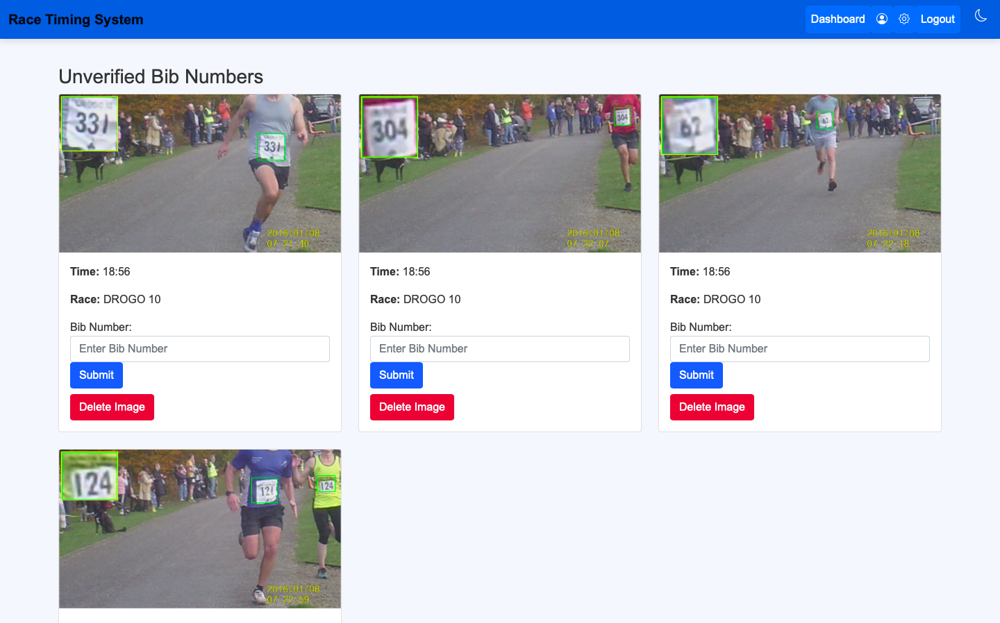
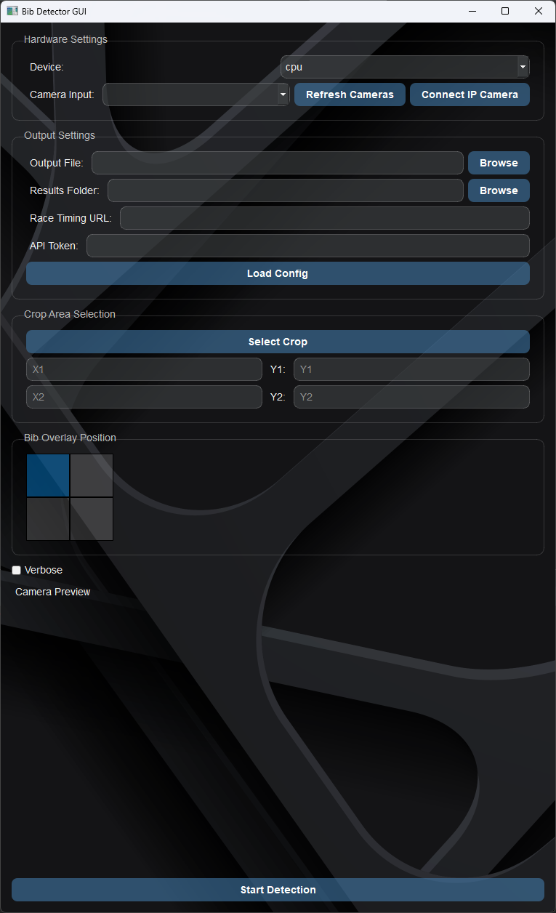

# Usage Guide – First Steps

## Overview - Django Website
The following guide covers the basic usage of the Automated Race Timing System. This will help you get started quickly
and complete a simple task to verify that the system installation works properly. 

### 1. Logging into the System

To access the system, follow these steps:

- Open a browser and navigate to the URL where the system is hosted, e.g., `http://127.0.0.1:8000/` for local
development.
- On the landing page, you will see two options: **Login** and **Register**.
  - If you already have an account, click **Login** and enter your credentials (username and password).
  - If you're a new user, click **Register** to create an account. After registration, you will be automatically logged
  in.

#### Screenshot of Login Page:


### 2. Configuring a Race

Create a race via the organiser dashboard:

#### Screenshot of Race Config Page:


### 2. Uploading Race Data (CSV)

After logging in, you can upload race participant data in CSV format. This is an essential step for setting up race
results and timings.

- Navigate to the **Upload Participants** page by going to: `Organiser Dashboard → Upload Participants`.
- On this page, you can select the CSV file that contains race data and the correct race and click **Upload**.

#### Screenshot of Upload Participant CSV Page:


### 3. Managing Participants

As an organiser or admin, you can manage participants' information from the **Manage Participants** page.

- Go to `Organiser Dashboard → [Race ID]`.
- On this page, you can view, edit, and delete participant records.

### 4. Viewing Race Results

After uploading race data, you can view the results on the **Race Details** page.

- Navigate to `Dashboard → [Race Name]`.
- This page will show the race leaderboard and the results for each participant.

#### Screenshot of Race Details Page:


### 5. Manual Bib Validation

If using the computer vision script, unknown bib numbers will require manual validation, this can be done by the gallery 
page

- Navigate to `Organiser Dashboard → [Race Name] → Manual Bib Validation (Gallery)`.
- This page will show the bibs which require validation.

#### Screenshot of Manual Bib Validation Page:



The website contains a host of other features. To see them all, explore the Dashboard and Navigation Menu, which include
tools for account management, real-time result viewing, and data export. Organisers can monitor race status, upload
timing data from the bib detection system, and update race configurations as needed. The system is designed to be
intuitive and accessible, even for users with minimal technical experience. For a full overview of capabilities, refer
to the user guide or explore the interface directly.

## Overview - Bib Detector Client
The following guide will demonstrate how to use the bib detector client.

### 1. Starting the Bib Detector Client
To start the bib detector client, load the virtual environment as instructed in [Installation Guide](installation.md).
Once the virtual environment is loaded, you can start the Bib Detector GUI with
```bash
bib_gui.py
```
This will load the user interface.




Starting from the top:
 - Device: Choose the hardware device to run the model on. It is recommended you run this on hardware acceleration (CUDA:0)
 - Camera Input: This drop down box allows you to select a camera from your available cameras. Additionally, if you have set up Droidcam as described in the [Installation Guide](installation.md), you can either select the phone connected via USB or type in the IP address and port number of the Droidcam (IP:PORT - eg. 127.0.0.1:4747). **NOTE**: When connecting to a camera over network, the preview will not work.
 - Output File: Saves the recording of the race locally
 - Results Folder: Saves a copy of the results to a CSV as well as still images of the runners and their bibs. 
 - Race Timing URL: URL to the race webpage.
 - API Token: Required for authentication. Copy from race management webpage.
 - Load Config: Load config that can be downloaded from race management webpage to autofill the above 2 required boxes.
 - Select Crop: Crop the camera feed.
 - Bib Overlay Position: Which corner the enlarged bib appears in the still images.
 - Camera Preview: Displays the currently selected camera. Does not work for IP cameras.

Once sufficient fields are filled, just click the start detection button and the Bib Detector Client will start and begin tracking and uploading results.