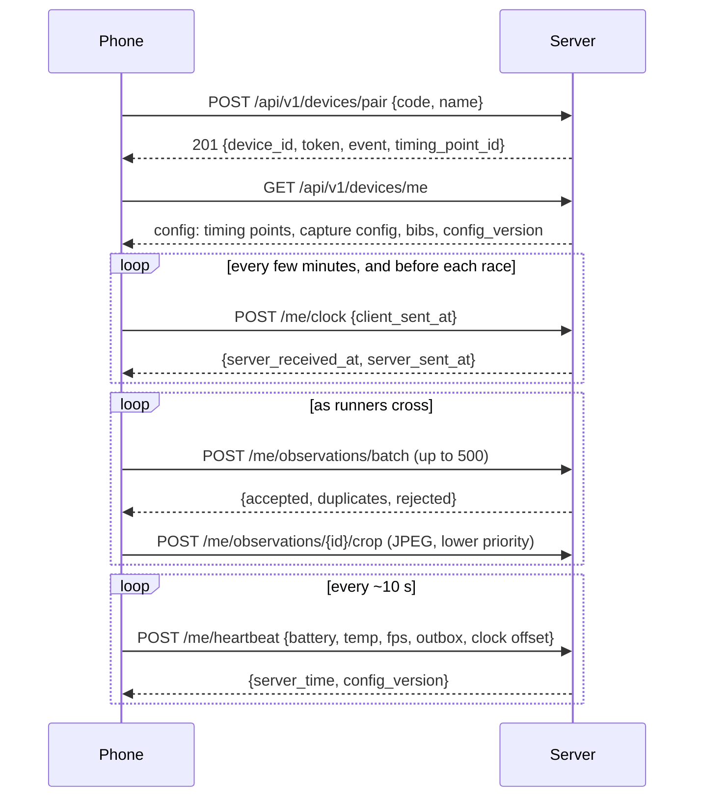

# protocol/

The contract between capture devices (phones, the replay simulator) and the server.

- [`openapi.json`](openapi.json) is the **source of truth**. It's generated from the server code (`uv run python manage.py export_openapi` in `server/`), and CI fails if it's out of date. Generate clients from it rather than writing them by hand.
- [`examples/`](examples/) holds example request bodies. A server test posts every one of them to the API, so they're always valid.

## Flow



## Pairing

An organiser creates a one-time pairing code (Django admin → *Pairing codes* for now). It's valid for **15 minutes** and **one device**, and can optionally put the device straight onto a timing point. The QR code holds:

```json
{"v":1,"server":"https://timing.example.org/","code":"7KQ2M9XD4F"}
```

Codes are 10 characters of Crockford base32. The server ignores case, spaces and hyphens, and reads O as 0 and I/L as 1, so people can type them too. Pairing is throttled to 10 attempts per minute per IP address.

In venue mode ([ADR 0002](../docs/decisions/0002-event-mode-and-accounts.md)) the payload will also carry `"fp"`, the laptop's TLS certificate fingerprint, for the app to pin. *Not implemented yet (Phase 6).*

## Authentication

Every call except `/pair` sends `Authorization: Bearer <token>`. The token is shown once, at pairing, so store it in the platform keystore. The server only keeps a hash. A revoked device gets `401` and has to pair again.

## Clock sync

Results are only as good as the clocks. Send `client_sent_at` (t0) from the device clock, note the device clock when the response arrives (t3), and read t1 = `server_received_at` and t2 = `server_sent_at`:

```
offset_ms = ((t1 - t0) + (t2 - t3)) / 2     # server time minus device time
rtt_ms    = (t3 - t0) - (t2 - t1)
```

Take several samples and keep the offset from the one with the **smallest round trip**. Re-sync every few minutes, because phone clocks drift. Report the current offset and round trip in each heartbeat so organisers can spot a bad clock.

## Observations

One observation = one runner crossing the line, as this device saw it.

- **`id`:** generate a UUID on the device (v7 recommended) *before* queueing. It's the idempotency key: resending a batch after a timeout is always safe.
- **`captured_at_device` + `clock_offset_ms`:** the frame's timestamp from the camera sensor (not the time processing finished), and the offset in use when it was captured. The server stores both and computes `captured_at = captured_at_device + offset`.
- **`candidates`:** bib guesses, best first, at most 5. Send an **empty list** when the bib couldn't be read. The observation still matters: it becomes an unknown read in the review queue.
- **`timing_point_id`:** leave it out to use the device's assigned timing point.

The response sorts every id into one of three lists:

| List | Meaning | What the device does |
|---|---|---|
| `accepted` | Stored now | Remove it from the outbox |
| `duplicates` | Already stored by an earlier upload | Remove it from the outbox |
| `rejected` | Will never be stored (`no_timing_point`, `timing_point_not_in_event`, `in_future`, `id_used_by_another_device`) | Remove it from the outbox and log it. Resending won't help |

On a network error or a `5xx`, keep the batch and retry with backoff. On a `422`, the batch itself is malformed: fix the app.

## Crops

`POST /me/observations/{id}/crop` with a multipart `image` field holding a JPEG of at most 512 KB. Upload crops after the observations, at lower priority. They're for human review, so a missing crop never blocks results. Uploading again replaces the previous crop.

## Config changes

`GET /me` returns a `config_version`. Each heartbeat response repeats the current one, so when it changes, fetch `/me` again. That's how new entries (bibs), a moved timing point or a new capture config reach the phone.

## Limits

| | |
|---|---|
| Observations per batch | 500 |
| Bib | 1-16 letters, digits or hyphens |
| Crop | JPEG, at most 512 KB |
| `captured_at` in the future | Rejected beyond 5 minutes |
| Clock offset | at most ±24 hours |
